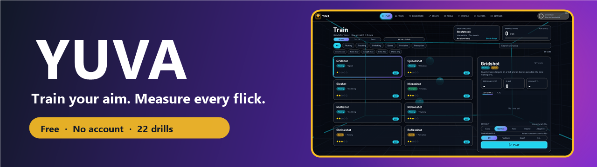
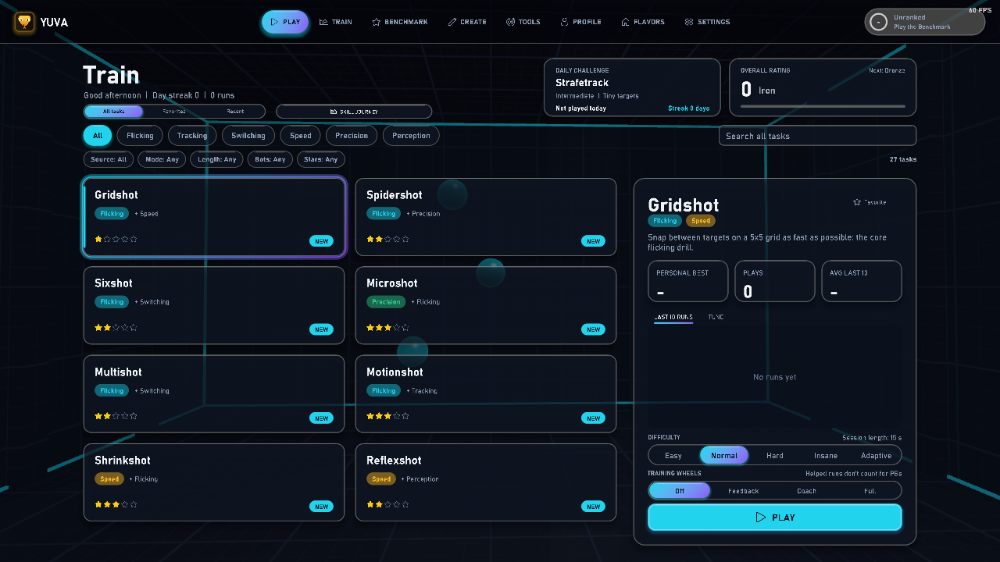
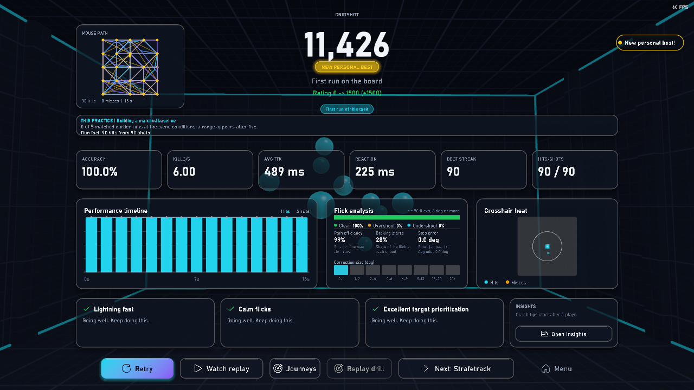
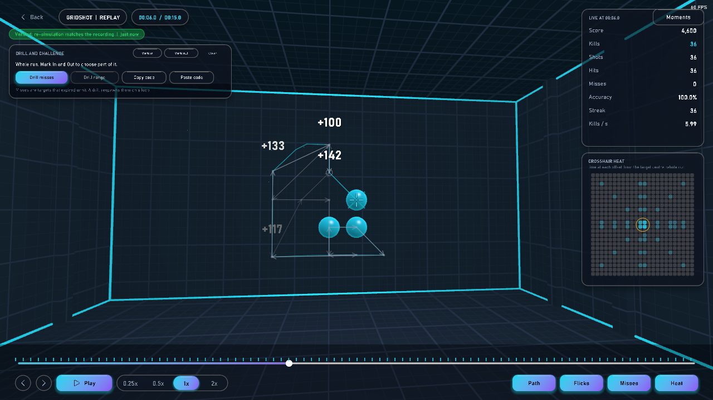
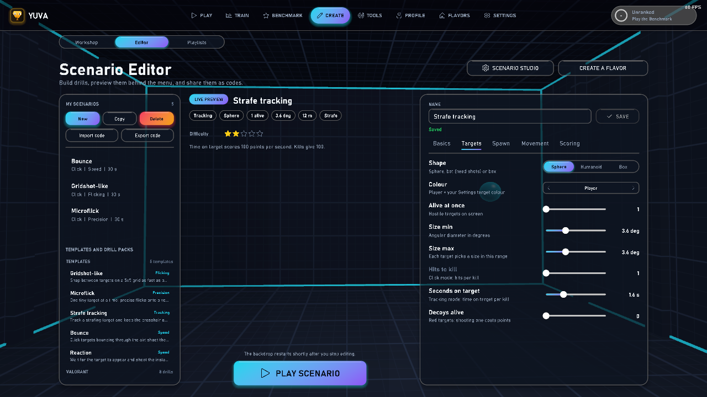
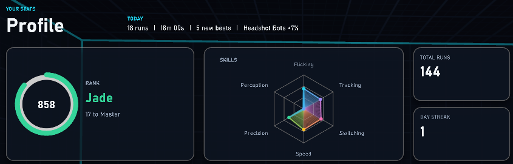

<p align="center">
  
</p>

<h3 align="center">Train your aim. Measure every flick. Free, local, no account.</h3>

<p align="center">
  <a href="https://github.com/computerologykj-maker/YuvaRelease/releases/latest"></a>
  <a href="https://github.com/computerologykj-maker/YuvaRelease/releases"></a>
  <a href="https://github.com/computerologykj-maker/YuvaRelease/stargazers"></a>
  
  
</p>

<p align="center">
  <a href="https://github.com/computerologykj-maker/YuvaRelease/releases/latest"></a>
</p>

<p align="center">
  <sub>Zip, checksum and signature files are on the <a href="https://github.com/computerologykj-maker/YuvaRelease/releases">releases page</a>.</sub>
</p>

---

## Why YUVA

- 🎯 **22 built-in drills across six skills.** Flicking, Tracking, Switching, Speed, Precision and Perception. Pick a difficulty from Easy to Insane, or let Adaptive adjust during a run.
- 🧭 **Training Wheels that fade.** Optional aids that step back as your raw aim improves. Runs with help stay out of personal bests and ratings, except on the Feedback only preset.
- 🔁 **Replays you can check.** Runs are recorded as inputs and re-simulated, and each replay is checked against its recorded result. Turn the targets you missed into a practice drill.
- 📈 **Progress you can see.** Results with a flick breakdown and crosshair heat, skill ratings, a radar, personal bests, charts and local leaderboards. Export your runs to CSV or JSON.
- 🎚️ **Sensitivity tools.** Match settings across 20 games, convert with cm/360 and save sensitivity profiles.
- 🎨 **Make it yours.** Crosshair editor with live preview, six arena themes, colour-vision palettes, reduced motion and UI scale. Raw mouse input and XInput gamepad aim.

Also inside: a Benchmark with 12 drills at three tiers, an Energy score and a daily challenge; a Scenario Editor for click and tracking drills, shareable as short codes; five built-in routines, your own playlists and a goal planner that builds a 1 to 4 week program; hit sounds that are synthesized, custom WAV or spatial; Aim Lab workshop maps and playlists read from your local Steam downloads; and KovaaK's scenarios read from a local install.

## Screenshots

> [!NOTE]
> The Results and Replay shots come from scripted runs on a throwaway profile. The Profile shot uses seeded sample data.

<table>
  <tr>
    <td width="50%" valign="top">
      <br>
      <sub><b>Train.</b> Task library, daily challenge and rating on a fresh profile.</sub>
    </td>
    <td width="50%" valign="top">
      <br>
      <sub><b>Results.</b> Score, personal best, flick analysis, crosshair heat and coaching tips.</sub>
    </td>
  </tr>
  <tr>
    <td width="50%" valign="top">
      <br>
      <sub><b>Replay.</b> Verified re-simulation with a path overlay and live stats.</sub>
    </td>
    <td width="50%" valign="top">
      <br>
      <sub><b>Scenario Editor.</b> Build click and tracking drills, then share them as short codes.</sub>
    </td>
  </tr>
  <tr>
    <td width="50%" valign="top">
      <br>
      <sub><b>Profile.</b> Rank, skill radar and totals. Sample data, seeded for this shot.</sub>
    </td>
    <td width="50%" valign="top"></td>
  </tr>
</table>

## Install

1. **Download** `YUVA-<version>-win64.zip` with its `.zip.sha256` and `.sig` files from the [releases page](https://github.com/computerologykj-maker/YuvaRelease/releases/latest).
2. **Extract** the whole zip into its own folder. Keep `YUVA.exe` beside the `resources` folder, and don't move `YUVA.exe` out on its own.
3. **Double-click** `YUVA.exe`. Windows may show a warning the first time you run it. If the game says Vulkan is missing, update your GPU driver, since the Vulkan loader comes from the driver and not from the package.

<details>
<summary><b>Verify your download</b></summary>

<br>

**Checksum (any player).** In PowerShell, in the folder that holds the zip, run:

```powershell
Get-FileHash .\YUVA-<version>-win64.zip -Algorithm SHA256
```

Compare the 64-character hash with the first field of the `.zip.sha256` file, which reads `<hash>  <zip name>`. Letter case doesn't matter. A match means the zip is the one that was packaged. The checksum file comes from the same release page, so this catches corruption and tampering in transit, but not a compromised release page.

</details>

## Your data and updates

- Settings, profile and replays are stored in `%APPDATA%\YUVA\`, outside the game folder.
- To remove the game, delete the game folder. To remove your local data, delete `%APPDATA%\YUVA\`.
- When a newer release exists, the main menu shows an update banner. The update check goes to GitHub.

## Requirements

- **System:** Windows 10 or 11, 64-bit only.
- **GPU:** a Vulkan-capable driver.
- **Tested so far:** an NVIDIA GPU on Windows, and a software Vulkan driver (SwiftShader) for functional tests. AMD and Intel GPUs, and 2016-era PCs, are not tested yet.
- **Mouse:** used for aiming with raw input. An XInput gamepad is optional.
- **Internet:** used only for the Steam Workshop lookup and download, SteamCMD, and the update check on GitHub. The code has no telemetry that we found.
- **Optional content:** Steam with Aim Lab (Steam app 714010), and a local KovaaK's install. Neither is bundled with YUVA.
- **CPU, RAM and disk:** no minimum is published yet.

## What's new

See the [releases page](https://github.com/computerologykj-maker/YuvaRelease/releases) for each version's zip and notes.

---

<p align="center">
  <a href="https://github.com/computerologykj-maker/YuvaRelease/releases"><b>Releases</b></a> &nbsp;·&nbsp; Free, with no paywall and no account needed.
</p>

<sub>YUVA is not affiliated with or endorsed by Aim Lab, KovaaK's, VALORANT, CS2, Apex Legends or Overwatch 2. Aim Lab and KovaaK's content is read only from local installs and is not bundled. This repository has no license file yet, so no reuse rights are granted.</sub>
